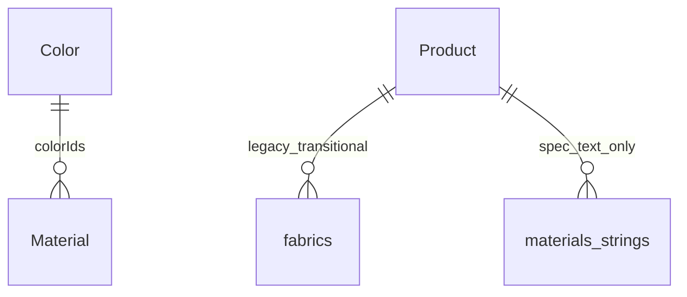

# Demo 9A — Central Materials & Colors Library

Admin-only foundation for reusable Color and Material entities. Products are **not** migrated in this demo.

## Architecture

**Option B (approved):** separate `Color` and `Material` collections. Material references Color via `colorIds: ObjectId[]`.



## Terminology (important)

| Field / concept | Meaning |
|-----------------|---------|
| `Product.materials: string[]` | **Legacy spec text** (e.g. "עץ אלון") — NOT the Material library |
| `Product.fabrics[]` | **Legacy configurator** — unchanged until Demo 9B |
| `Material` collection | **New central library** — configurable domain entity |
| Future `Product.materialOptions` | Planned Demo 9B name for product ↔ library assignment |

Do not overload `Product.materials` for library assignments.

## Color model

- `nameHe`, optional `nameEn`, optional `code`, `hex`, `isActive`, `sortOrder`
- `hex` normalized to uppercase `#RRGGBB` (3-digit expanded)
- `hex` is **not** unique; names are **not** unique
- `code` optional, sparse unique when set
- Blank/whitespace `code` → unset (never `""`)
- Non-empty `code` → trim + uppercase before persist

## Material model

- `nameHe`, optional `nameEn`, optional `code`, `type` enum, `colorIds[]`, `isActive`, `sortOrder`
- Types: `FABRIC`, `LEATHER`, `WOOD`, `METAL`, `GLASS`, `FINISH`, `OTHER`
- Same optional `code` normalization as Color

## Material ↔ Color rules

**Create Material:** all selected colors must exist and be active.

**Update Material:**
- Previously linked colors may remain even if inactive
- Newly added colors must exist and be active
- Server enforces — client cannot submit inactive color ObjectIds manually

## Swatches (deferred)

Do **not** attach a global swatch image to Color. Future swatches likely belong to **Material + Color** (same HEX looks different on Velvet vs Leather). Not modeled in 9A.

## Recolor / masks (deferred)

- Stable identity: `Color._id` + `Color.hex`
- Masks are **Product-specific** — never on Color or Material
- Future: base image + product mask + selected `Color.hex` → client recolor
- Automatic segmentation (SAM/AI) — future phase only

## Admin routes

```
/admin/colors, /admin/colors/new, /admin/colors/[id]
/admin/materials, /admin/materials/new, /admin/materials/[id]
```

Nav: ראשי | מוצרים | קטגוריות | צבעים | חומרים

## Lifecycle

- No hard delete — use `isActive`
- Deactivation does not mutate existing Material color references

## Out of scope (9A)

Product assignment, public configurator migration, swatch uploads, masks, recoloring, legacy `fabrics[]` removal.

## Deferred (9B+)

- `Product.materialOptions` assignments
- Legacy → library migration
- Public configurator wired to HEX
- Material+Color swatch images (Blob)
- Canvas mask renderer
- Automatic mask generation
